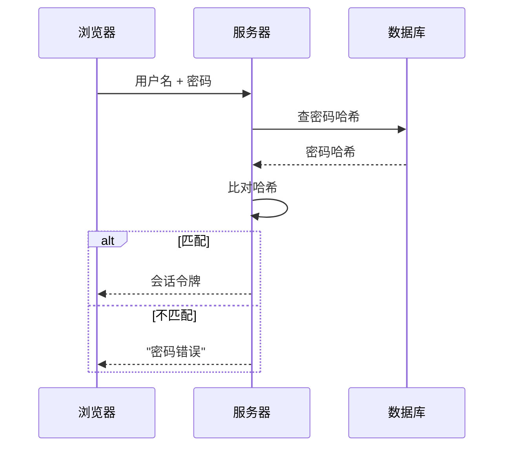

# 第 2 级：图表

## 什么时候用

内容的核心是**结构**：谁连着谁、先后顺序、因果、层级、状态之间的迁移。文本只能一句一句描述结构，读者要在脑子里拼装；图表一次把它摊开。

## 第 1 步：选类型

| 内容 | 类型 | Mermaid |
| --- | --- | --- |
| 步骤与分支 | 流程图 | `flowchart LR` / `flowchart TD` |
| 多方互相发消息 | 时序图 | `sequenceDiagram` |
| 状态之间的迁移 | 状态图 | `stateDiagram-v2` |
| 父子、包含关系 | 层级图 | `flowchart TD`，或 `mindmap` |
| A 导致 B，B 影响 C | 因果图 | `flowchart LR`，边上标「增大」/「减小」 |
| 两三个东西逐项比较 | 表格 | Markdown 表格（表格也是图表） |

一张图只回答一个问题。两个问题就画两张图。

## 第 2 步：先写第 1 级草稿

写出纯文本草稿（按第 1 级规则）。每个节点和每条边都必须在这个草稿里出现过。图表不新增事实。

## 第 3 步：画

1. 每个框 ≤8 个词或 ≤8 个汉字。名词放框里，动词放边上。
2. 节点 ≤12 个。超过就拆成两张图，或把细节收进一个子流程框。
3. 同类的东西用同样的形状。例如：数据用圆角框，步骤用矩形，判断用菱形。
4. 只用一个方向：从左到右，或从上到下。
5. 术语与草稿完全一致。草稿说「令牌」，图里就不能写「凭证」。

输出位置：

- 聊天界面能渲染 Mermaid 时，输出 Mermaid 代码块。
- 布局、配色或标注本身重要时，在工作目录写单文件 SVG 或 HTML。
- Mermaid 中，标签含括号、引号或冒号时要加引号：`A["输入 (x)"]`。`stateDiagram-v2` 里的非 ASCII 状态名要声明：`state "已支付" as paid`。

## 第 4 步：说明怎么读

图下用 2~4 句写清**怎么读这张图**：

> 从左往右读。矩形是步骤，菱形是判断。红色边是出错路径。

## 示例

问题：「用户登录时，浏览器、服务器和数据库之间发生了什么？」

怎么读：时间从上往下。实线箭头是请求，虚线箭头是响应。方框部分是两个结果，只会发生一个。
